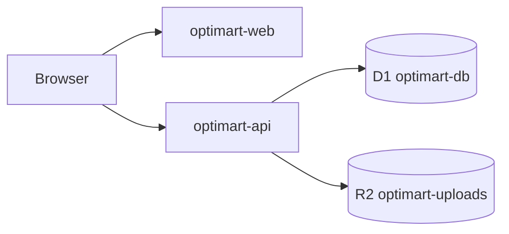

# Deploy ขึ้น Cloudflare Workers

ระบบ deploy เป็น 2 Workers จาก monorepo เดียว:

| Worker | โฟลเดอร์ | Bindings | หน้าที่ |
|---|---|---|---|
| `optimart-api` | `apps/server` | D1 `DB` → `optimart-db`, R2 `BUCKET` → `optimart-uploads` | REST API (Hono) + เสิร์ฟไฟล์ `/uploads/*` จาก R2 |
| `optimart-web` | `apps/web` | static assets | หน้าเว็บ Next.js (ผ่าน `@opennextjs/cloudflare`) |



D1 และ R2 **ไม่ต้องสร้างเอง** — `wrangler.jsonc` ไม่ได้ใส่ id ไว้ ดังนั้น `wrangler deploy` จะสร้างให้อัตโนมัติตอน deploy ครั้งแรก (automatic resource provisioning)

## ต้องมีก่อน

- Node.js 20+ และ `npm install` ที่รากโปรเจกต์แล้ว
- บัญชี Cloudflare ที่เปิด `workers.dev` subdomain แล้ว (Workers & Pages → ครั้งแรกจะให้ตั้งชื่อ)
- ล็อกอิน: `npx wrangler login` หรือ (CI) ตั้ง `CLOUDFLARE_API_TOKEN` + `CLOUDFLARE_ACCOUNT_ID`
- Windows: OpenNext แนะนำ WSL แต่ build บน Windows ได้ (มีแค่ warning)

## Deploy (คำสั่งเดียว)

```bash
npm run deploy:check   # build + dry run ทั้ง 2 Workers — ไม่อัปโหลดอะไร ไม่ต้องล็อกอิน
npm run deploy         # deploy จริง
npm run seed:remote    # (ครั้งแรกเท่านั้น, ไม่บังคับ) ใส่ข้อมูลตัวอย่าง — ลบข้อมูลเดิมทั้งหมด!
```

`npm run deploy` (`deploy.mjs`) ทำตามลำดับ:

1. ตรวจว่าล็อกอิน Cloudflare แล้ว
2. ถ้า Worker ยังไม่มี secret `JWT_SECRET` → สุ่มค่าใหม่แล้วอัปโหลดไปพร้อม deploy (ครั้งต่อไปใช้ค่าเดิม)
3. deploy `optimart-api` → สร้าง D1/R2 ให้ถ้ายังไม่มี
4. `wrangler d1 migrations apply optimart-db --remote`
5. ตั้ง `CORS_ORIGIN` ของ API เป็น URL ของเว็บ (`https://optimart-web.<subdomain>.workers.dev`)
6. build เว็บด้วย `NEXT_PUBLIC_API_URL=<URL ของ API>` แล้ว deploy `optimart-web`

URL ทั้งคู่ดึงจาก output ของ wrangler อัตโนมัติ

### ใช้ custom domain

ตั้ง env ก่อนรัน แทนการเดาจาก `workers.dev`:

```bash
API_URL=https://api.example.com WEB_ORIGIN=https://shop.example.com npm run deploy
```

(ผูก domain ให้แต่ละ Worker ใน dashboard หรือเพิ่ม `routes` ใน `wrangler.jsonc` ของแต่ละแอป)
`WEB_ORIGIN` รองรับหลาย origin คั่นด้วย comma

## Deploy แยกทีละแอป

```bash
npm run deploy -w @optimart/server   # API + remote migrations
NEXT_PUBLIC_API_URL=https://optimart-api.<subdomain>.workers.dev npm run deploy -w @optimart/web
```

ข้อควรระวัง: deploy แยกจะไม่ใส่ `CORS_ORIGIN` ให้ — ค่าใน `apps/server/wrangler.jsonc` คือ `http://localhost:3000` (สำหรับ local) ให้เพิ่ม `--var CORS_ORIGIN:https://...` หรือใช้ `npm run deploy` ที่ราก

## Deploy อัตโนมัติจาก GitHub (Workers Builds)

ใน Cloudflare dashboard → Workers & Pages → Create → Import a repository เชื่อม repo นี้ **2 ครั้ง**:

| Worker | Root directory | Deploy command | Build watch paths | Build variables |
|---|---|---|---|---|
| `optimart-api` | `apps/server` | `npm run deploy` | `apps/server/**` | — |
| `optimart-web` | `apps/web` | `npm run deploy` | `apps/web/**` | `NEXT_PUBLIC_API_URL` |

ตั้ง `JWT_SECRET` ครั้งเดียวด้วย `npx wrangler secret put JWT_SECRET` (ใน `apps/server`) และ `CORS_ORIGIN` เป็น Variable ของ `optimart-api` ใน dashboard
(ถ้าตั้ง var ใน dashboard ให้เปลี่ยน deploy command เป็น `npx wrangler deploy --keep-vars && npx wrangler d1 migrations apply optimart-db --remote` เพื่อไม่ให้ค่าถูกทับ)

## เปลี่ยน schema ฐานข้อมูล

```bash
# แก้ apps/server/src/db/schema.js แล้ว
npm run db:generate -w @optimart/server   # สร้างไฟล์ drizzle/*.sql ใหม่ (commit ไฟล์นี้)
npm run db:migrate  -w @optimart/server   # apply บน local
npm run deploy                            # apply บน remote อัตโนมัติ
```

ห้ามแก้ไฟล์ migration ที่ apply ไปแล้ว — สร้างไฟล์ใหม่เสมอ
หมายเหตุ: deploy อัปโหลดโค้ดก่อนแล้วค่อย apply migration — โค้ดที่ต้องใช้ตาราง/คอลัมน์ใหม่อาจ error ไม่กี่วินาทีระหว่างนั้น

## ข้อจำกัด / สิ่งที่ควรรู้

- **Free plan**: CPU 10ms/request — รหัสผ่านใช้ PBKDF2 (Web Crypto) แทน bcrypt เพื่อให้ผ่าน limit; ขนาด Worker เว็บ ~1.1 MiB gzip (limit 3 MiB)
- รหัสผ่าน bcrypt จากระบบเดิมใช้ไม่ได้ — ต้อง seed ใหม่หรือให้ผู้ใช้สมัครใหม่
- `seed:remote` **ลบข้อมูลทั้งหมด** ใน D1 ก่อนใส่ข้อมูลตัวอย่าง — ใช้ครั้งแรกเท่านั้น
- ไฟล์ใน R2 เข้าถึงผ่าน `optimart-api/uploads/*` เท่านั้น (bucket ไม่ได้เปิด public)
- ดู log สด: `npx wrangler tail optimart-api` / `npx wrangler tail optimart-web`
- Rollback: `npx wrangler rollback` ในโฟลเดอร์ของแอปนั้น (ไม่ rollback ข้อมูล D1 — ใช้ D1 Time Travel: `npx wrangler d1 time-travel restore optimart-db --timestamp=...`)
